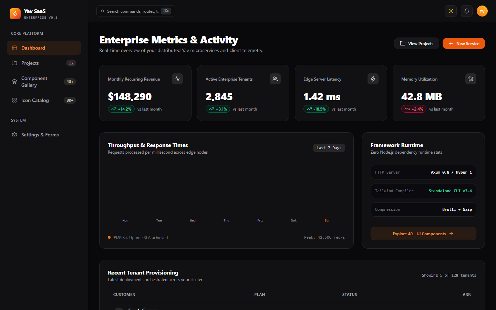
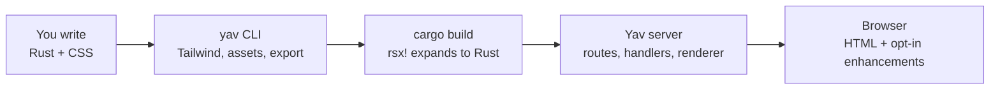
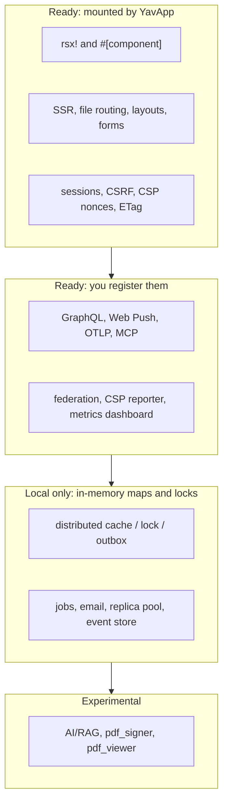
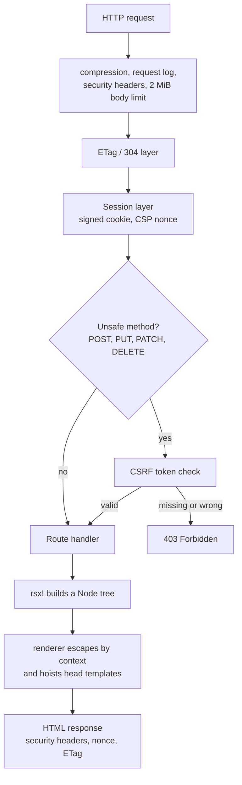
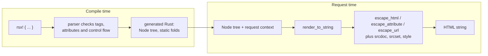
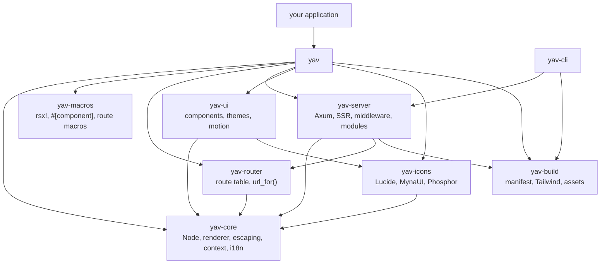

<p align="center">
  
</p>

<h1 align="center">Yav.rs</h1>

<p align="center">
  Write pages in Rust. Ship HTML. Skip the Node toolchain.
</p>

<p align="center">
  <a href="https://crates.io/crates/yav"></a>
  <a href="https://docs.rs/yav"></a>
  <a href="LICENSE-MIT"></a>
</p>

<p align="center">
  
</p>

<p align="center">
  <em>The included example dashboard. Pages are written in Rust and delivered as
  HTML — no JavaScript framework to install. <a href="examples/dashboard/">Run it</a>.</em>
</p>

---

Yav is a small web framework for server-rendered HTML. Components are Rust
functions; `rsx!` gives them a JSX-like syntax and expands them into a `Node`
tree at compile time. At request time the renderer walks that tree and escapes
each value according to where it lands: text, attributes, URLs, `style`,
`srcdoc`, and JSON-LD blocks all have different rules. Routes come from the
directory layout. The CLI handles project scaffolding, a standalone Tailwind
binary, asset hashing, and static export.

The HTTP layer is [Axum](https://github.com/tokio-rs/axum). There is no
JavaScript bundler, no hydration runtime to install, and nothing that needs
Node.js.

## The short version

Rust has excellent HTTP libraries. What it has not had, unless you assembled
it yourself, is a way to *write a page*: a component syntax, a renderer,
conventions for where files go, and a dev command that just works. That
assembly is what Yav is.

> One language, one build, one framework crate. The browser receives HTML.

If you already like Axum, Yav is the view layer you were going to write
anyway. If you are coming from Next.js or Remix, the routing and component
model will look familiar, but `node_modules` will not appear in your project.

The difference is easier to see side by side. This is a rough map, not a
benchmark, and the JS ecosystem is far more mature than a 0.1.x Rust project:

| | Bare Axum | Typical JS full-stack | Yav |
|---|---|---|---|
| Views | pick a template crate | JSX / TSX components | `rsx!` in Rust |
| Build | `cargo` | `npm` + bundler + Node | `cargo` + one `yav` binary |
| CSRF, CSP, sessions | wire them up yourself | framework-dependent | on by default |
| Browser JavaScript | whatever you add | hydration | optional data attributes |

Three concrete consequences:

- **Escaping is contextual.** A value in `href` is not escaped like a value in
  a text node; `srcdoc`, `srcset`, `style` and JSON-LD get their own rules. A
  single `escape()` applied everywhere cannot cover those contexts.
- **Security defaults are on.** CSRF validation, signed session cookies and a
  per-response CSP nonce are active without configuring a thing.
- **Interactivity is opt-in.** The HTML works on its own. Motion, live updates
  and form enhancements are added with data attributes, not a hydration step.

## The mental model, in five steps

1. You put components and route handlers in `.rs` files, and styles in a CSS
   file.
2. The `yav` CLI runs Tailwind, hashes assets and can export a static build.
3. `cargo build` expands `rsx!` into ordinary Rust. There is no template
   interpreter waiting at request time.
4. The server matches the URL to a file-based route, runs the middleware stack,
   and calls your handler.
5. Your handler returns a `Node`; the renderer escapes and serializes it. The
   browser gets HTML.



Everything else in this README is detail on one of those five boxes.

## Before you start

This is **0.1.x**. Some parts are finished, some are library modules you mount
yourself, and some are single-process prototypes whose names oversell them.
The [documentation](#documentation) describes each module's scope and maturity.

One practical wrinkle: the `0.1.5` archive on crates.io declares
`rust-version = 1.75`, enables all three icon families and does not expose the
`full-icons` feature described below. Version `0.1.8` needs **Rust 1.88** and
enables only the Classic family by default; use `full-icons` to restore the
whole catalog.

### Where things stand



Read the arrows as "fewer guarantees, more assembly required". Out of the box
`YavApp` mounts only `/health`, `/healthz`, `/readyz`, `/metrics`,
`/_yav/image`, `/_yav/og` and `/_yav/vitals`. CSRF protection is on by default,
so a state-changing form needs `_csrf`, or an AJAX request needs the
`x-csrf-token` header. Nothing named "distributed" survives a second process.

That makes the intended reader fairly specific. Yav fits you if you are
building an SSR application, an internal tool or a dashboard in Rust and want
to move fast without adopting a JavaScript toolchain. It does not fit you yet
if you need a spec-complete GraphQL server (use `async-graphql`), cluster-wide
state, or a framework with years of production deployments behind it. Saying
so up front saves everyone time.

## Getting started

```bash
cargo install yav-cli
yav new my-app
cd my-app
yav dev
```

A whole application also fits in one file. This one compiles as-is:

```rust
use yav::prelude::*;

#[tokio::main]
async fn main() -> std::io::Result<()> {
    let app = YavApp::new().port(3000).get("/", |_req| async {
        html_response(
            StatusCode::OK,
            render_to_string(&rsx! {
                <main class="p-8">
                    <h1>"Hello from Rust"</h1>
                    <p>"No Node toolchain, no JS bundler."</p>
                </main>
            }),
        )
    });
    app.serve().await
}
```

Read that file against the five steps above: `rsx!` (step 3) builds the page,
`.get("/", …)` registers the file-based route (step 4), `render_to_string`
escapes and serializes it (step 5), and `serve()` starts the Axum listener.
There is no hidden build step between the Rust source and the response.

`yav new` lays out a project like this:

```text
my-app/
├── package.yavml            server, Tailwind, scripts, dependencies
├── src/
│   ├── main.rs
│   ├── routes/
│   │   ├── mod.rs
│   │   ├── index.rs          /
│   │   ├── about.rs          /about
│   │   └── users/
│   │       └── _id_.rs       /users/:id
│   └── layouts/
│       └── app_layout.rs     shared shell
└── public/
    └── styles.css
```

`auto_routes!` scans that tree at compile time. Dynamic segments are written
`_id_` rather than `[id]` so the file is also a valid Rust module name. Route
groups, parallel slots and intercepting routes are covered in
[`docs/routing.md`](docs/routing.md).

## How a request is served

The middleware stack is ordinary Tower layers. From the outside in:



Sessions use an ephemeral CSPRNG secret when `SESSION_SECRET` is not set, so
cookies are not signed with a publicly known constant. They also do not survive
a restart in that case; set the variable in production. Rate limiting is
optional and off unless you add it.

## From `rsx!` to HTML

Most of the work happens before the server starts. The macro parses the markup,
rejects mismatched tags at compile time, and folds literal subtrees into
`Node::Static` so they cost nothing to render again.



Here is the whole idea in one example. Given a value you do not control:

```rust
let name = "<script>alert(1)</script>";
let html = render_to_string(&rsx! { <h1 class="title">{name}</h1> });
```

`html` is exactly:

```html
<h1 class="title">&lt;script&gt;alert(1)&lt;/script&gt;</h1>
```

There is no `escape()` call in your code and nothing to remember. The renderer
knows `{name}` is a text node and applies the right rules. Put the same value
in an `href` and URL rules apply instead; `escape_url` rejects unsafe schemes.
That is the part a single generic escape helper cannot cover.

Components are plain functions. `Motion` below is a builder that emits CSS
custom properties and a small Web Animations script, so the animation still
works with a strict CSP:

```rust
use yav::prelude::*;
use yav::ui::{Button, Motion, MotionState, Transition};

#[component]
pub fn Hero() -> Node {
    let title = Motion::new()
        .child(rsx! {
            <h1 class="text-5xl font-black">"Vitesse & Élégance"</h1>
        })
        .initial(MotionState::new().opacity(0.0).y(20.0).scale(0.95))
        .animate(MotionState::new().opacity(1.0).y(0.0).scale(1.0))
        .transition(Transition::spring().stiffness(180.0).damping(16.0));

    rsx! {
        <main class="min-h-screen p-12">
            {title}
            <Button variant="primary">"Explorer le catalogue"</Button>
        </main>
    }
}
```

The `#[component]` macro generates a `HeroProps` type even when the function
takes no arguments; in RSX you write `<Hero />`. Raw markup is available
through the `Node::Raw` variant, but it bypasses escaping. Only use it for
static, trusted strings.

## Workspace layout

Nine crates. `yav` is the facade most applications import; everything below it
can also be used on its own.



`yav-cli` is a separate binary that embeds its own copy of the VS Code
extension, so `yav ext install` works offline. The icon catalog is generated
Rust source; `yav` enables the Classic family by default (~1,900 variants) and
`features = ["full-icons"]` links all three (~13,600). See
[`docs/icons.md`](docs/icons.md).

## What else is in the box

Yav is not a thin wrapper. It ships **82 UI components** across **56 modules**,
bundled with **8 themes**, a **~1,900-icon** classic set (and **~13,600** more
behind the `full-icons` feature), and **57 server modules** for sessions, CSRF,
auth, jobs, graphs and streaming. A short index first; the component names below
it are real, taken from `yav-ui`. The full component catalogue lives in
[`docs/components.md`](docs/components.md).

| Area | Entry points | State |
|---|---|---|
| Rendering | `rsx!`, `#[component]`, `Node`, `Head`, `PageMeta` | ready |
| UI | `yav-ui`: drawers, charts, grids, editors, 8 themes, motion | ready |
| Routing | `auto_routes!`, `typed_routes!`, `url_for()` | ready |
| Server | `YavApp`, sessions, `CsrfConfig`, `SecurityHeadersConfig` | ready |
| Forms and data | `FromFormData`, `#[server]`, `CsvBuilder`, `PdfDocument` | library |
| Auth | `JwtManager`, `Totp`, `PasskeyManager`, `RebacGraph`, `PolicyEngine` | library |
| Observability | `YavApp::otel(true)`, `OtelTracer`, `SecurityAuditor`, `CspReporter` | opt-in automatic HTTP spans; DB/AI spans still manual |
| Integrations | `GraphQlSchema`, `WebPushNotification`, `FederationGateway`, `McpServer` | library, not mounted |
| Images | `ImagePipeline`, `WebPEncoder` | WebP output only; no AVIF encoder |
| Build | `package.yavml`, Tailwind CLI, `yav export` | ready |
| Local primitives | `DistributedCache`, `DistributedLock`, `TransactionalOutbox`, `DbReplicaPool` | in-memory, single process |
| Experimental | `ai`, `pdf_signer`, `pdf_viewer` | library modules |

The integrations added from the [competitive roadmap](docs/competitive-roadmap.md)
are real adapters, but they are compiled only when their Cargo feature is
enabled: SQL drivers, executable migrations, tagged cache, durable jobs, SMTP,
object storage, an HTTP LLM client, Garde validation, schema helpers, OAuth2,
Argon2id, an OTLP exporter, a11y linting, advanced Markdown and Fluent i18n.
See [Opt-in integrations](docs/opt-in-integrations.md) for the feature names,
entry points and the boundaries that still apply.

A few things that are easy to misread. The GraphQL executor is a small
top-level field resolver (no fragments, variables or directives) with a
hand-written playground page, not GraphiQL 3.x. `pdf_signer` produces an HMAC
integrity tag, not a PAdES/X.509 signature. `SecurityAuditor` computes a local
header heuristic, not an OWASP certification. With no Cargo feature enabled,
the service adapters are explicitly named test mocks and return errors; the
opt-in features above replace them with real drivers.
The metrics dashboard reads real `OtelTracer` counters and shows `0` for
anything that is not instrumented.

### The component library

`yav-ui` exposes 82 components. They are grouped below by what they are for; the
names are the actual exported functions.

**Layout & structure** — `Container`, `Grid`, `Stack`, `Card` (+ `CardHeader`,
`CardTitle`, `CardDescription`, `CardContent`, `CardFooter`), `Separator`,
`ResizablePanels`, `Skeleton`

**Navigation** — `Navbar`, `Sidebar` (+ `SidebarItem`), `Breadcrumbs`, `Tabs`,
`Stepper`, `Pagination`, `Accordion` (+ `AccordionItem`), `Dropdown`,
`CommandMenu` (+ `CommandGroup`, `CommandItem`), `Link`, `Kbd`, `Button`

**Forms & inputs** — `Form` (+ `FormField`, `FormGroup`), `Input`, `Textarea`,
`Checkbox`, `Switch`, `Radio`, `Select`, `Combobox`, `DatePicker`, `InputOtp`,
`RangeSlider`, `Slider`, `FileDropzone`, `ProgressBar`, `ScrollProgressBar`

**Data display** — `Table`, `DataGrid`, `StatCard`

**Charts** — `LineChart`, `BarChart`, `DonutChart`, `Sparkline`, `AnimatedBar`

**Feedback & overlay** — `Alert`, `Toast` (+ `ToastContainer`), `EmptyState`,
`Loading`, `Tooltip`, `Dialog`, `Drawer`, `Sheet`, `Popover`

**Media & content** — `Image`, `CodeBlock`, `Avatar`, `Carousel`, `Badge`

**Motion & interaction** — `Motion` (+ `MotionGroup`), `CursorFollower`,
`CursorSpotlight`, `Magnetic`, `TiltPlate`, `TypewriterCode`, `CountUp`,
`Counter`, `Island`

**Theming & meta** — `MetaTags`, `ThemeSelector`, `ThemeToggle`, `Label`

The complete list, with props and usage, is in
[`docs/components.md`](docs/components.md).

## CLI

| Command | What it does |
|---|---|
| `yav new <name> [--check]` | Scaffold a project; `--check` verifies it with `cargo check` |
| `yav dev` | Dev server with live reload and error overlay |
| `yav build` | Release binary and purged CSS |
| `yav export` | Static site generation into `dist/` |
| `yav routes` | Print the resolved route table |
| `yav doctor` | Check toolchains and project health (exits non-zero on failures) |
| `yav check` | Validate manifest and syntax |
| `yav test` | Run the test suite |
| `yav add <component>` | Add UI templates to the project |
| `yav codegen --ts --openapi` | Emit TypeScript interfaces and an OpenAPI 3.1 spec |
| `yav icon search` | Query the compiled icon catalog (`list` and `info` too) |
| `yav db` | Migrations (needs `DATABASE_URL` and a DB client) |
| `yav deploy <target>` | Generate Fly.io, Railway, Shuttle or systemd config |
| `yav ext install` | Install the editor extension (`status` inspects it) |

The complete command list is in [`docs/cli.md`](docs/cli.md). `yav codegen --ts`
emits framework and route types; it does not parse arbitrary Rust structs.

## Documentation

| Topic | Guides |
|---|---|
| Start | [Getting started](docs/getting-started.md) · [Configuration](docs/configuration.md) · [CLI reference](docs/cli.md) |
| Building UI | [Components](docs/components.md) · [Styling](docs/styling.md) · [Icons](docs/icons.md) · [Themes](docs/themes.md) · [Zero-JS motion](docs/zero-js-interactions-and-motion.md) |
| Server | [Architecture](docs/architecture.md) · [Routing](docs/routing.md) · [Dev server](docs/development-server.md) · [Production](docs/production.md) · [Security](docs/security.md) |
| Details | [Opt-in integrations](docs/opt-in-integrations.md) · [SEO and metadata](docs/seo-and-metadata.md) · [Interactivity and HTMX](docs/interactivity-and-htmx.md) · [Competitive roadmap](docs/competitive-roadmap.md) |
| Project | [Changelog](CHANGELOG.md) · [Contributing](CONTRIBUTING.md) · [Security policy](SECURITY.md) |

## Examples

[`examples/dashboard`](examples/dashboard/) is a full application: KPI cards,
dynamic routes, a component gallery, an icon explorer and a CSRF-protected
settings form. It is excluded from the workspace, so check it separately:

```bash
cargo test --manifest-path examples/dashboard/Cargo.toml --locked
```

[`test-app`](test-app/) is a second, smaller demo project.

If the five-step model above matches how you want to work, start with
`yav new my-app`. Everything else here is reference material.

## License

Dual-licensed under [MIT](LICENSE-MIT) or [Apache-2.0](LICENSE-APACHE), at
your option.

Icon catalogs keep their own licenses: Lucide (ISC), MynaUI (MIT), Phosphor
(MIT). The texts ship with the `yav-icons` crate; see
[`assets/ATTRIBUTION.md`](assets/ATTRIBUTION.md).

## Author

[Isaac Yav](https://github.com/isaacvay).
